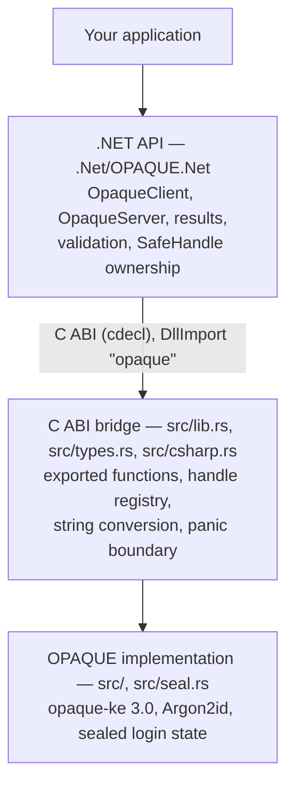

[Docs](../README.md) › Development › **Architecture**

# Architecture

Cyphra OPAQUE.Net has three layers:

1. **.NET API**: `OpaqueClient`, `OpaqueServer`, result types, validation, and safe-handle ownership in `.Net/OPAQUE.Net`.
2. **C ABI bridge**: the exported Rust functions (`src/lib.rs`, `src/types.rs`) and the string and handle helpers in `src/csharp.rs` convert protocol inputs and outputs across the native boundary. Every export runs inside a panic boundary.
3. **OPAQUE implementation**: Rust code in `src/`, backed by `opaque-ke` 3.0, Argon2, randomness, and serialization dependencies.

## Native boundary

**Loading.** The C# wrapper calls the native library with `DllImport("opaque", CallingConvention = CallingConvention.Cdecl)`. The library is loaded by `NativeLibraryResolver`, only from the directories the .NET host resolved for the application (see [native library loading](../security/secure-use.md#design-notes-and-known-limits)).

**Ownership.** Native strings and result objects come back through `SafeHandle`-based wrappers and are released by the matching Rust functions.

- **Result handles** are never-reused tokens that own their result, not memory addresses. Once a result is freed, its handle stays dead: a repeated or stale release, or a token presented as the wrong result type, finds nothing.
- **String handles** are tracked in a registry of live strings, so a repeated release is ignored instead of freeing memory twice. Strings are wiped before they are freed.

**Inputs.**

- Input strings must be valid UTF-8, NUL-terminated values no larger than 64 KiB.
- Passwords and identifiers have a 1 KiB (UTF-8 bytes) limit, and the C# wrapper rejects embedded NUL and unpaired surrogates.
- Passwords and `serverSetup` are passed as pinned UTF-8 buffers that are zeroed after the call.
- `KSFConfig` crosses as numbers: the profile as `i32` and the costs as `u32`.
- `null`, invalid UTF-8, oversized values and null result handles fail the operation instead of being interpreted as empty strings.

Any change to an exported function, string encoding, ownership rule, or result layout must update both sides and include tests.

**Packaging.** The package stores platform-specific binaries under `runtimes/<rid>/native/`. The .NET project maps the repository file names (see [native assets](building.md#native-assets)) to the name P/Invoke probes for on each OS. The managed assembly targets `net8.0` and `net10.0`.

## State and secrets

Protocol state is carried between individual client and server calls. Server login state is sealed (authenticated encryption keyed from `serverSetup`, bound to the user identifier; see `src/seal.rs` and [sealed login state](../security/secure-use.md#sealed-login-state)), which keeps the server stateless. The unsealed state never crosses the native boundary.

The library does not provide a database, session store, transport, account service, or secret manager. The application owns:

- protecting `serverSetup`;
- associating `RegistrationRecord` with the correct account;
- authenticating the transport and authorizing the resulting session;
- limiting login attempts and monitoring abuse;
- securely handling `ExportKey` and session keys;
- providing atomic first-use storage for `tryConsume` when it runs more than one instance.

## Error boundary

Managed validation rejects empty required inputs, oversized or malformed strings, and unsafe custom KSF values before invoking native code. Native protocol failures become a failed operation (`false` and a null result). `FunctionHelper.TryExecute` rethrows process-level faults (out of memory, stack overflow, marshalling, SEH) instead of reporting them as a failed login. Server login additionally exposes an infrastructure exception through an output parameter, so applications can keep internal diagnostics separate from externally safe authentication responses.

When modifying this boundary, test invalid inputs, incorrect passwords, identifier mismatches, KSF mismatches, native failures, and native resource cleanup.

## ABI evolution

The current ABI is kept for compatibility with released native assets. Its `char*` inputs require a readable NUL-terminated buffer, a limitation of the original contract. Result handles are already opaque tokens. A future versioned ABI should also use `(pointer, length)` input pairs, explicit status codes, and a status-to-public-error mapping in .NET. New functionality belongs on that versioned surface rather than changing existing symbols in place.

---

**Next:** [Building and testing](building.md) · **See also:** [Secure use and known limits](../security/secure-use.md)
