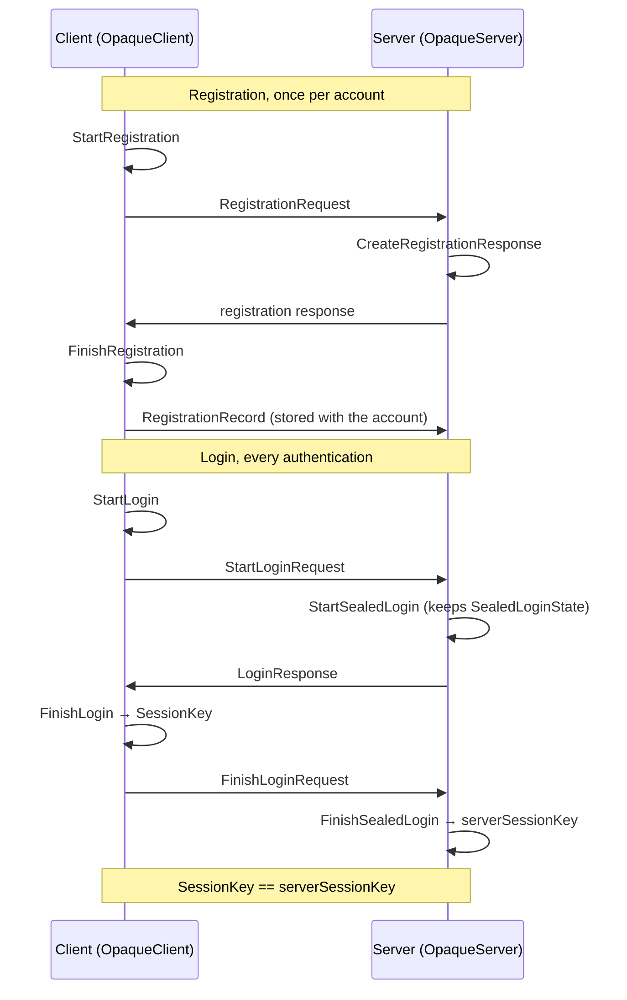

[Docs](../README.md) › Guide › **Usage and protocol flow**

# Usage and protocol flow

The public API is split into `OpaqueClient` and `OpaqueServer` (namespace `OPAQUE.Net`; result types in `OPAQUE.Net.Types.Results`). Each protocol message is a string. State values must be passed to the next step and must not be mixed between concurrent flows. Every method is described in the [API reference](../reference/api.md).



## Server setup

Create the server setup once:

```csharp
var server = new OpaqueServer();

if (!server.CreateSetup(out string? serverSetup) || serverSetup is null)
    throw new InvalidOperationException("Unable to create server setup.");
```

Store `serverSetup` in a secrets manager or equivalent protected storage. It is a long-term secret. A new setup produces a different server public key and makes old registration records unusable.

The corresponding public key can be obtained without exposing the setup secret. Calling it at startup also validates a `serverSetup` loaded from storage:

```csharp
server.GetPublicKey(serverSetup, out string? serverPublicKey);
```

An application may pin or otherwise verify this public key at its own protocol boundary.

## Registration

Registration has three messages:

```csharp
var client = new OpaqueClient();
const string password = "user password";
const string userIdentifier = "user-123";

if (!client.StartRegistration(password,
    out StartClientRegistrationResult? start) || start is null)
    throw new InvalidOperationException("Client registration could not start.");

if (!server.CreateRegistrationResponse(
    serverSetup, userIdentifier, start.RegistrationRequest,
    out string? response) || response is null)
    throw new InvalidOperationException("Server registration could not start.");

if (!client.FinishRegistration(
    password, response, start.ClientRegistrationState,
    out FinishClientRegistrationResult? finish) || finish is null)
    throw new InvalidOperationException("Client registration could not finish.");

// Store with the account, never in logs:
string registrationRecord = finish.RegistrationRecord;
string exportKey = finish.ExportKey;
string serverStaticPublicKey = finish.ServerStaticPublicKey;
```

Only `registrationRecord` is required by the server for later login. The export key is client-side material and should be handled as a secret.

## Login

Login has four steps and produces the same session key on both sides:

```csharp
if (!client.StartLogin(password,
    out StartClientLoginResult? clientStart) || clientStart is null)
    throw new InvalidOperationException("Client login could not start.");

if (!server.StartSealedLogin(
    serverSetup,
    clientStart.StartLoginRequest,
    userIdentifier,
    registrationRecord,
    out StartSealedServerLoginResult? serverStart,
    out Exception? infrastructureError) || serverStart is null)
{
    throw new AuthenticationException("Login could not start.", infrastructureError);
}

if (!client.FinishLogin(
    clientStart.ClientLoginState,
    serverStart.LoginResponse,
    password,
    out FinishClientLoginResult? clientFinish) || clientFinish is null)
    throw new AuthenticationException("Invalid credentials.");

if (!server.FinishSealedLogin(
    serverSetup,
    userIdentifier,
    serverStart.SealedLoginState,
    clientFinish.FinishLoginRequest,
    replayCache.TryConsume,
    out string? serverSessionKey) || serverSessionKey is null)
    throw new AuthenticationException("Login could not be completed.");

// clientFinish.SessionKey and serverSessionKey must be equal.
```

What to do with each value:

- **Only `LoginResponse` goes to the client.** `SealedLoginState` stays on the server. It is encrypted, tamper-proof and expires after two minutes, so any server-side store works (cache, database), on any instance that shares the same `serverSetup`.
- **The state finishes only for the `userIdentifier` it was started with, and only once.** For a single instance, `replayCache` is one process-wide [`LoginStateReplayCache`](../reference/api.md#loginstatereplaycache) (a static field or a DI singleton, never a new one per request). For several instances, use shared atomic storage such as Redis `SET NX`.
- **Unknown users still get a response.** For an unknown account, pass `null` (or an empty string) as `registrationRecord` and run the rest of the flow as usual: the server answers with a dummy response so the reply does not reveal whether the account exists (see [account-existence timing](../security/secure-use.md#design-notes-and-known-limits)).

The overloads that accept `clientIdentifier` and `serverIdentifier` bind the exchange to additional context. Use stable, canonical values and pass exactly the same values during registration and login. A mismatch must fail authentication.

## Argon2id settings

The default `KSFConfig` is memory-constrained. Applications can select the RFC draft recommendation or a validated custom configuration:

```csharp
using OPAQUE.Net.Types.Parameters;

var recommended = KSFConfig.CreateRfcDraftRecommended(allowHighMemoryProfile: true);
var custom = KSFConfig.Create(
    KSFConfigType.Custom,
    iterations: 1,
    memory: 65536,
    parallelism: 4);
```

- **Use the same configuration for registration and login.** Changing it for existing records makes login fail, so treat it as part of the credential format and migration plan.
- **Custom values are range-checked before the native call:** 1–10 iterations, 64 MiB–256 MiB memory (in KiB), parallelism 1–16.
- **`RfcDraftRecommended` is an explicit opt-in** and needs about 2 GiB per operation; deploy it only where that per-request memory budget exists. Since 1.6.0 it uses exactly 2^21 KiB as in draft-irtf-cfrg-opaque-16 (before, 2^21 − 1): records registered with the old value must be registered again.
- **Never pick the profile from untrusted input.**

## Failure handling

| Outcome | What happens | What to do |
| --- | --- | --- |
| Protocol failure (wrong password, tampered or expired message, identifier or KSF mismatch) | The method returns `false` and a null result | Answer with one generic failure |
| Invalid argument: empty, embedded `\0`, unpaired surrogate, too long | Throws an `ArgumentException` (`StringParamIsEmptyException` or `ArgumentOutOfRangeException` included) before any native call | When the value comes from a remote user, catch it and answer with the same generic failure |
| Invalid custom KSF values, or `KSFConfig.Create(KSFConfigType.RfcDraftRecommended)` | Throws | Fix the configuration; use `CreateRfcDraftRecommended(true)` |
| `StartSealedLogin` infrastructure fault | Returns `false` and sets the `Exception` output | Log it server-side; answer with the generic failure |
| Missing or wrong-architecture native library | Throws `DllNotFoundException`, `EntryPointNotFoundException` or `BadImageFormatException` | A deployment fault: let it surface and log it, do not map it to a failed login (see [platforms](platforms.md)) |

Passwords and identifiers are limited to 1024 UTF-8 bytes; protocol messages to 64 KiB. Do not turn these outcomes into detailed authentication errors visible to remote users, because that can disclose account or protocol state.

---

**Next:** [Supported platforms](platforms.md) · **See also:** [API reference](../reference/api.md), [Secure use](../security/secure-use.md)
